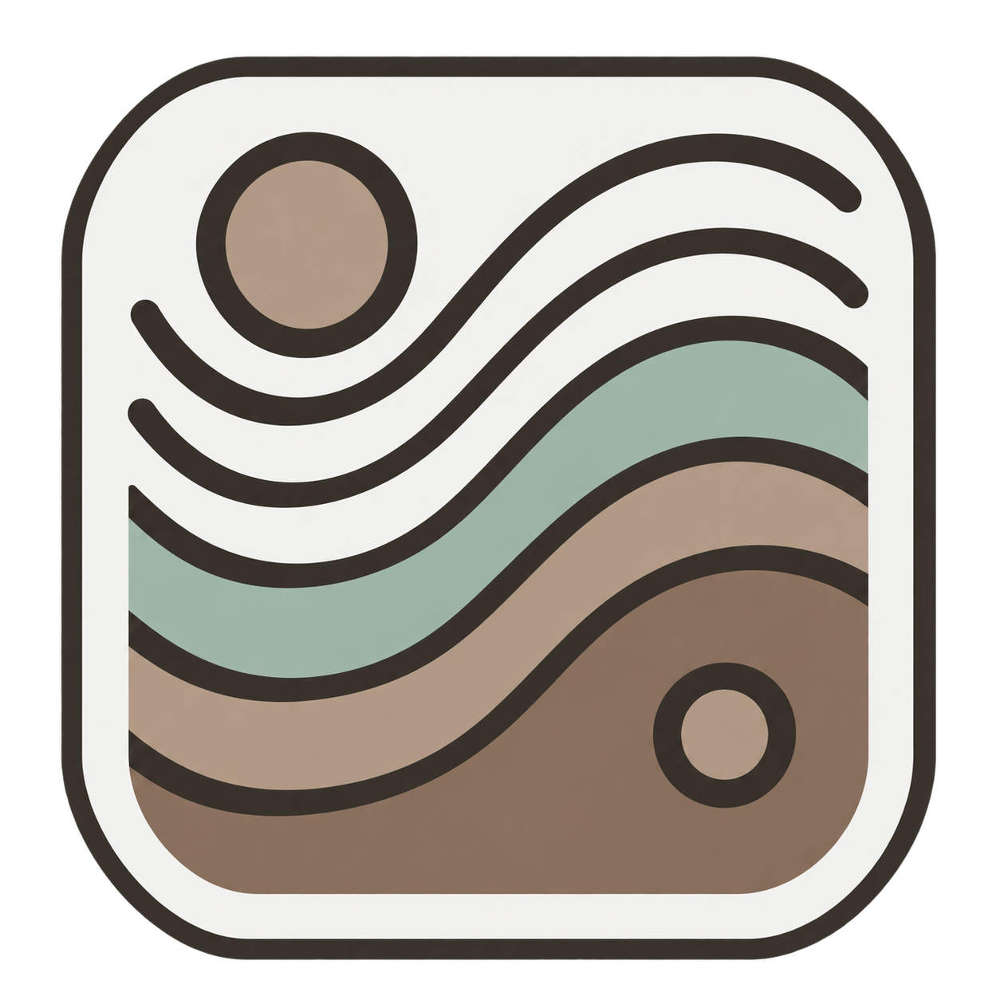
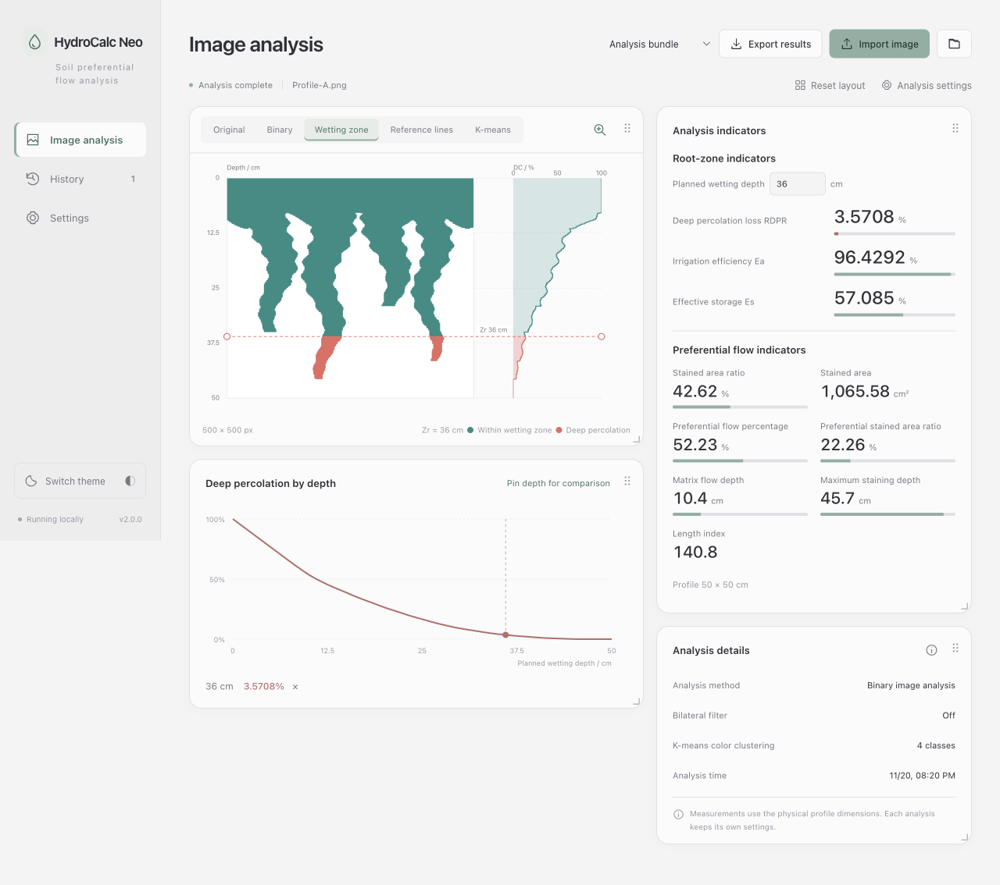
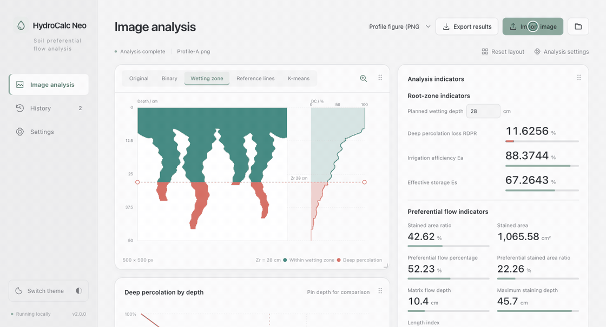
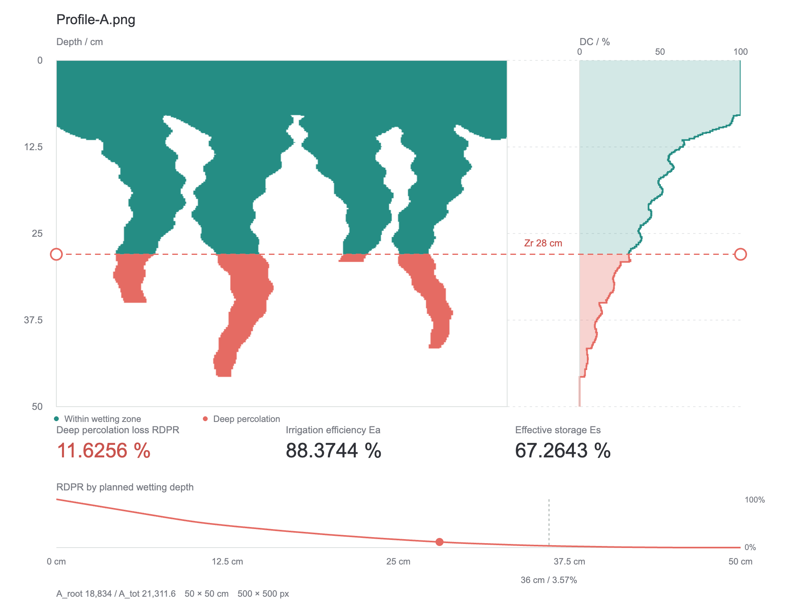

<p align="center">
  
</p>

<h1 align="center">HydroCalc Neo</h1>

<p align="center">A desktop app for analyzing preferential flow in stained soil profiles.</p>

<p align="center">
  <a href="https://github.com/lnk137/HydroCalc-Neo/actions/workflows/desktop.yml"></a>
  <a href="#quick-start"></a>
  <a href="https://nodejs.org/en/download"></a>
</p>

<p align="center">English · <a href="README.zh-CN.md">简体中文</a></p>



*The screenshots and demos use synthetic soil profiles.*

## Features

- **Calibrate and segment.** Enter the profile's measured width and depth. Import a stained PNG or JPEG and adjust HSV thresholds and denoising, or analyze a black-on-white mask directly.
- **Inspect preferential flow.** Measure stained area, preferential flow percentage, matrix flow depth, and maximum staining depth. Compare the original image, binary mask, reference lines, and K-means results.
- **Explore the wetting zone.** View the stained profile and depth curve on a shared scale. Drag the wetting boundary to preview how deep percolation loss (RDPR), irrigation efficiency (Ea), and effective storage (Es) change. Pin depths to compare them.
- **Run batches and revisit results.** Import multiple images or an entire folder, check each item's status, and open earlier results with their saved settings. Settings, images, and history stay on your device. HydroCalc Neo reads data from the previous desktop version.
- **Export the data you need.** Save images and profile figures as PNG, indicators and depth profiles as CSV, pixel matrices as Excel, or an entire batch as a ZIP with a summary CSV.

See the [metric definitions](docs/METRICS.md) for formulas and units.

## Quick start

Requires Node.js 24, CMake 3.24+, and a C++17 toolchain. On macOS, install the Xcode Command Line Tools and Ninja. On Windows, install Visual Studio 2022 with the Desktop development with C++ workload.

Clone this repository and run these commands from its root:

```sh
npm ci
npm run build:native
npm run dev
```

In **Analysis settings**, enter the profile dimensions and import your first image. Open **Wetting zone** to adjust the planned wetting depth, or choose an export format in the toolbar.

## Demos

### Adjust the wetting depth

Drag the red line to preview the updated metrics. Releasing it reruns the analysis and saves a separate history entry.


### Analyze and export a batch

Import multiple profiles, switch between their results, and save the batch as a ZIP.



### Export a profile figure

Choose **Profile figure (PNG)** to save the annotated profile, depth curves, and indicators in one image.

<p align="center">
  
</p>
