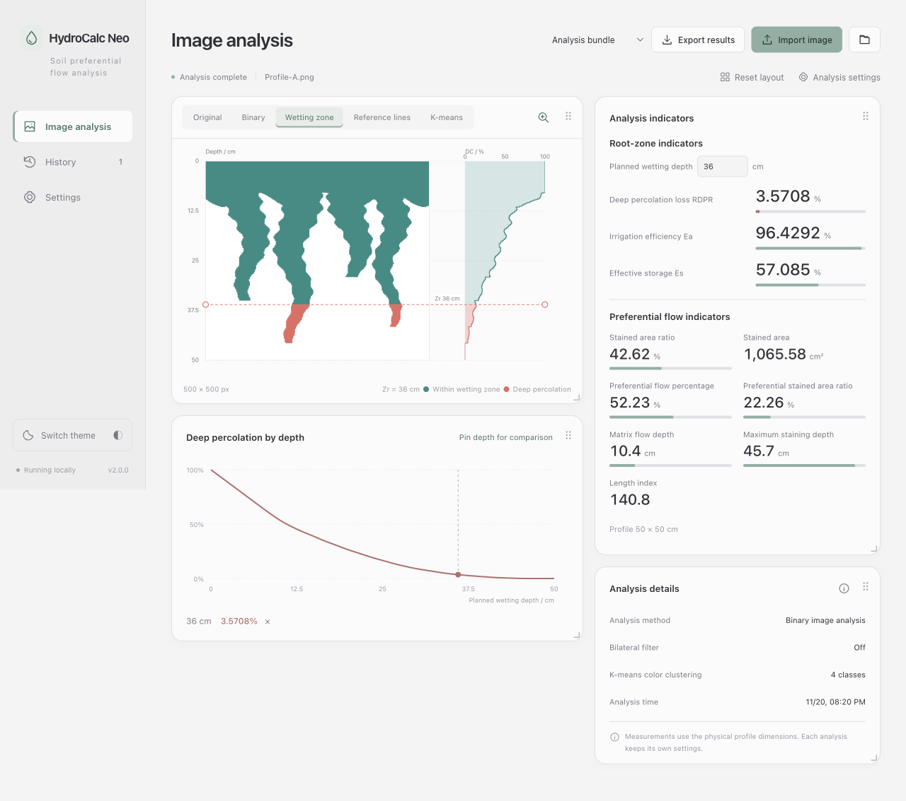
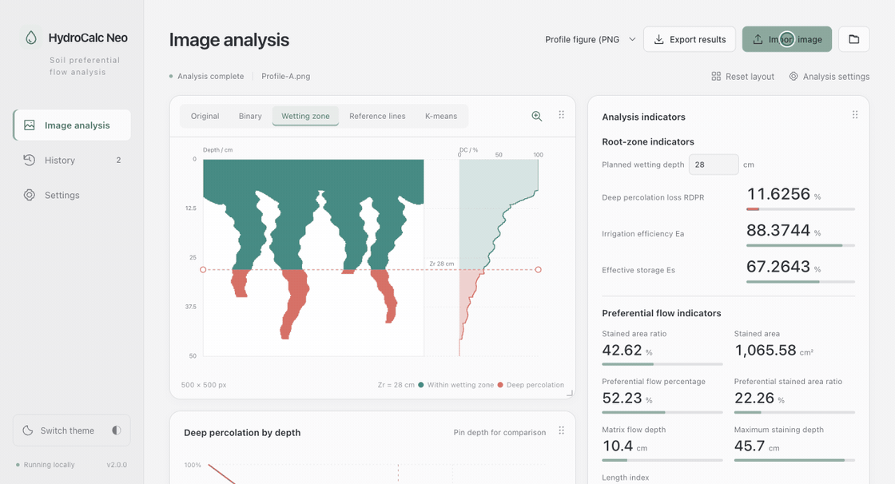
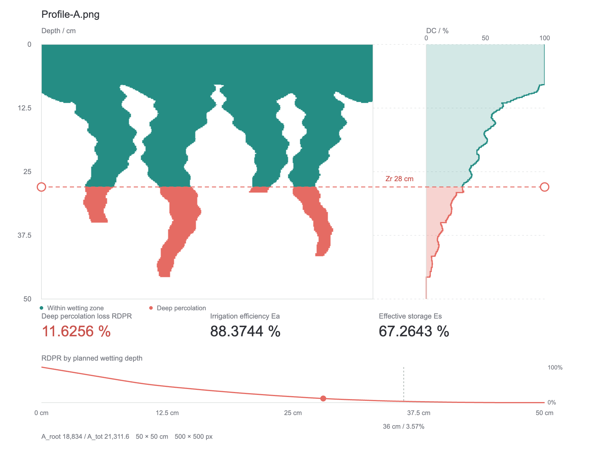

<p align="center">
  
</p>

<h1 align="center">HydroCalc Neo</h1>

<p align="center">用于分析土壤染色剖面优先流的桌面软件。</p>

<p align="center">
  <a href="https://github.com/lnk137/HydroCalc-Neo/actions/workflows/desktop.yml"></a>
  <a href="#快速开始"></a>
  <a href="https://nodejs.org/en/download"></a>
</p>

<p align="center"><a href="README.md">English</a> · 简体中文</p>



*截图和动图均使用合成土壤剖面。*

## 功能

- **剖面标定与染色分割。** 输入剖面的实际宽度和深度。导入 PNG 或 JPEG 染色照片后可调整 HSV 阈值和降噪参数，也可直接分析白底黑色的二值掩膜。
- **查看优先流指标。** 计算染色面积、优先流百分数、基质流深度和最大染色深度，对照原图、二值图、参考线和 K-means 聚类结果。
- **交互调整湿润层。** 在同一深度轴上查看染色剖面和曲线，拖动边界可实时预览深层渗漏损失率（RDPR）、灌水效率（Ea）和有效储水率（Es）。还可固定多个深度作比较。
- **批量分析与历史回查。** 一次导入多张图片或整个文件夹，逐项查看进度和结果。每条历史保留当时的分析参数。设置、历史和图片保存在本机，新版可读取原桌面版的数据。
- **按需导出。** 可保存 PNG 图像和剖面图版、CSV 指标和深度曲线、Excel 像素矩阵，以及包含汇总 CSV 的批量 ZIP。

公式和单位见[指标定义](docs/METRICS.md)。

## 快速开始

需要 Node.js 24、CMake 3.24+ 和 C++17 工具链。macOS 需安装 Xcode 命令行工具和 Ninja。Windows 需安装 Visual Studio 2022 并勾选「使用 C++ 的桌面开发」。

克隆本仓库后，在根目录运行以下命令。

```sh
npm ci
npm run build:native
npm run dev
```

先在「分析参数」里填入实际剖面尺寸，再导入图片。打开「湿润层」视图即可调整计划湿润层深度，也可以从工具栏选择导出格式。

## 操作演示

### 调整湿润层深度

拖动红线时可以预览指标变化，松手后软件会自动重新分析并保存一条独立历史。


### 批量分析与导出

同时导入多张剖面图，在各项结果之间切换，再导出整个批次的 ZIP。



### 导出剖面图版

选择「剖面图版（PNG）」，把分色剖面、深度曲线和分析指标一起保存为一张图。

<p align="center">
  
</p>
